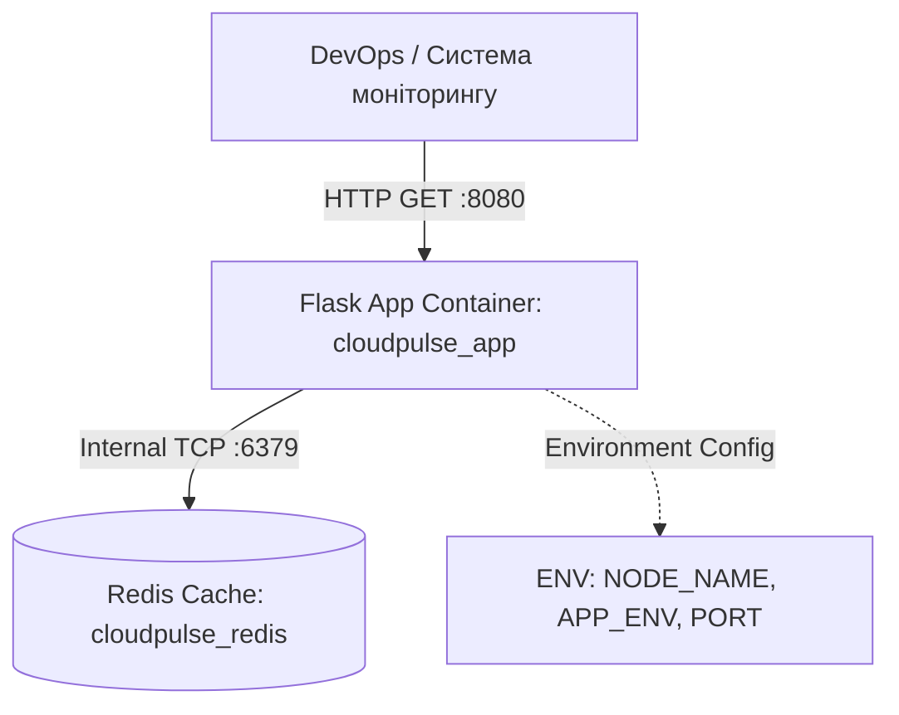

# CloudPulse Telemetry API

[](https://github.com/vitaliikohutiak25-dev/cloudpulse-ci/actions/workflows/ci.yml)

CloudPulse Telemetry API — це мікросервіс моніторингу працездатності серверних вузлів на базі Python (Flask) та бази швидкого кешування Redis, упакований у контейнери Docker із налагодженим CI/CD конвеєром у GitHub Actions.

---

## 1. Архітектура системи (C4 Container Level)

Взаємодія компонентів сервісу описується наступною контейнерною діаграмою:



- **Веб-сервер (Flask):** приймає вхідні HTTP-запити, зчитує системні метадані та транслює статус.
- **Швидкий кеш (Redis 7.2):** використовується для збереження лічильників сесій та обробки телеметрії.
- **Мережевий простір (pulse_net):** ізольований міст (bridge), закритий від зовнішнього несанкціонованого доступу.

---

## 2. Системні вимоги та технологічний стек
- **Мова та фреймворк:** Python 3.11, Flask 3.1.3
- **Тестування та якість:** Pytest 8.2, Pylint 3.2, Bandit, pip-audit
- **Контейнеризація:** Docker Engine >= 24.0, Docker Compose >= 2.20
- **CI/CD:** GitHub Actions (Матриця Python 3.10 / 3.11)

---

## 3. Інструкція розгортання та запуску

### Варіант А: Запуск через Docker Compose (Рекомендовано)
1. Клонувати репозиторій:
   ```bash
   git clone https://github.com/vitaliikohutiak25-dev/cloudpulse-ci.git
   cd cloudpulse-ci
   ```
2. Підняти стек у фоновому режимі:
   ```bash
   docker compose up -d --build
   ```
3. Перевірити працездатність:
   ```bash
   curl http://localhost:8080/
   ```

### Варіант Б: Локальний запуск для розробки
```bash
pip install -r requirements.txt
python app/main.py
```

### Запуск автоматизованих тестів:
```bash
python -m pytest -v
```

---

## 4. Специфікація API Endpoints

| Метод | Ендпоінт | Опис | Очікувана відповідь |
|---|---|---|---|
| `GET` | `/` | Перевірка працездатності сервісу (Health Check) | `{"service": "...", "status": "ONLINE", "node": "...", "environment": "..."}` |

---

## 5. Відомі обмеження та майбутні покращення
- **Поточне обмеження:** Ендпоінт `/` не потребує обов'язкової передачі JWT-токена (відкритий моніторинг).
- **Майбутній розвиток:** Впровадження захисту за стандартом OAuth2, Rate Limiting (захист від DoS) та експорт метрик у форматі Prometheus.
